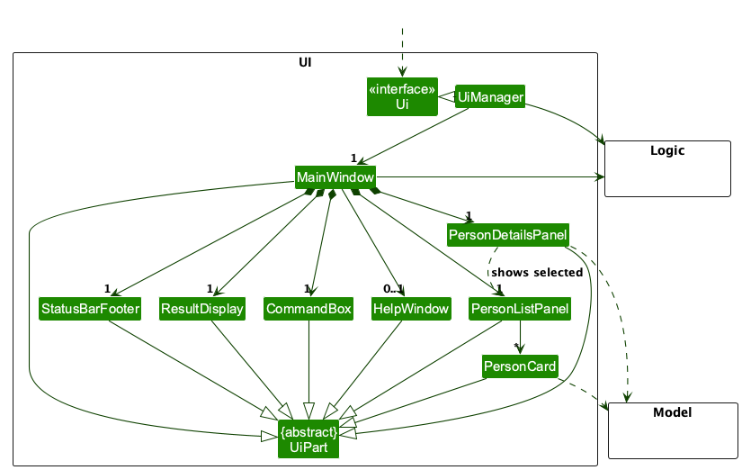
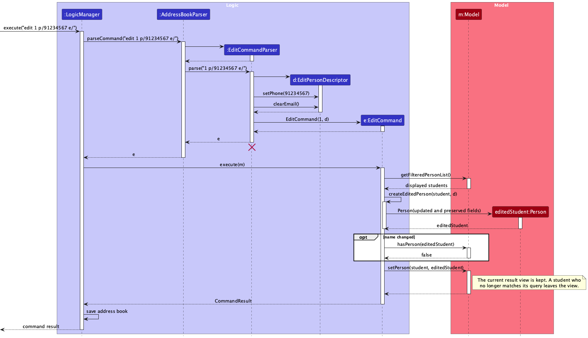
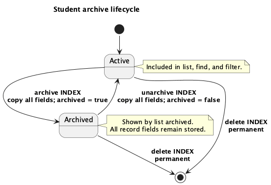
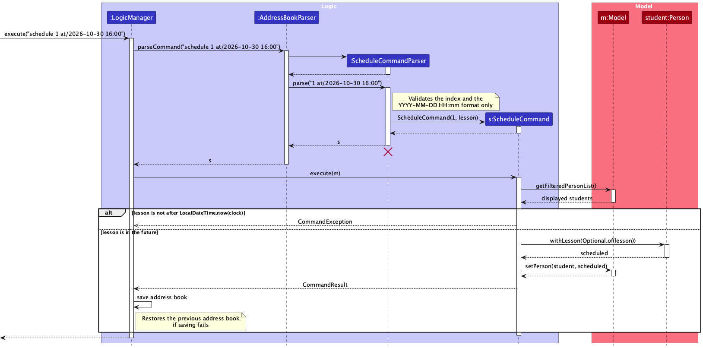
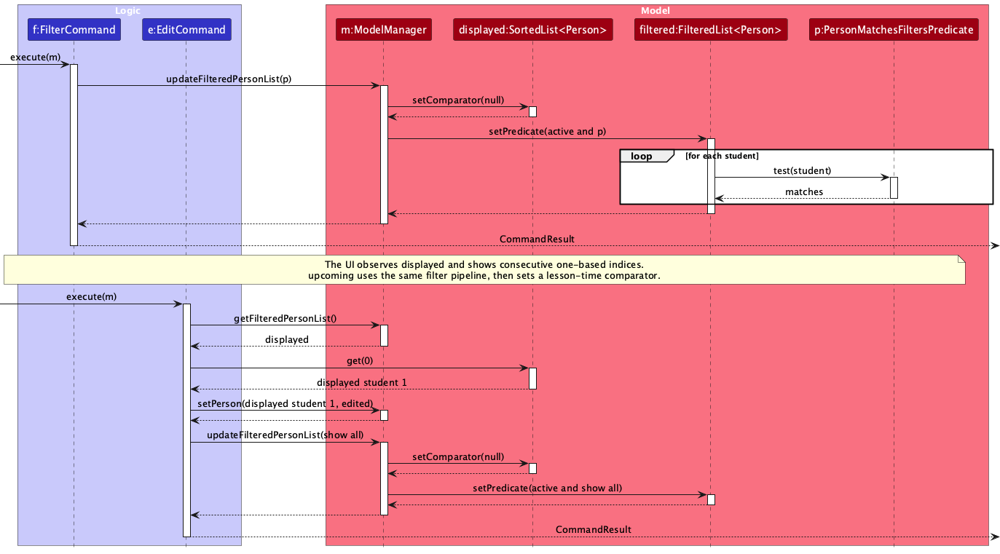
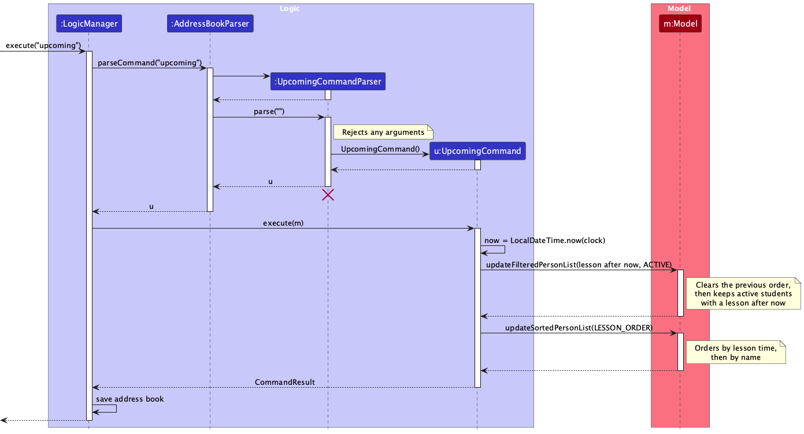

* Table of Contents
{:toc}

--------------------------------------------------------------------------------------------------------------------

## **Acknowledgements**

* TutorContacts is based on the [AddressBook-Level3](https://github.com/se-edu/addressbook-level3) project created by the [SE-EDU initiative](https://se-education.org/).
* TutorContacts uses [JavaFX](https://openjfx.io/), [Jackson](https://github.com/FasterXML/jackson), and [JUnit 5](https://junit.org/junit5/).

--------------------------------------------------------------------------------------------------------------------

## **Setting up, getting started**

Refer to the guide [_Setting up and getting started_](SettingUp.md).

--------------------------------------------------------------------------------------------------------------------

## **Design**

:bulb: **Tip:** The `.puml` files used to create diagrams are in `docs/diagrams`. Refer to the [_PlantUML Tutorial_ at se-edu/guides](https://se-education.org/guides/tutorials/plantUml.html) to learn how to create and edit diagrams.

### Architecture

The ***Architecture Diagram*** given above explains the high-level design of the App.

The following provides a quick overview of the main components and their interactions.

**Main components of the architecture**

**`Main`** (consisting of classes [`Main`](https://github.com/AY2627S1-CS2103T-W10-3/tp/tree/master/src/main/java/seedu/address/Main.java) and [`MainApp`](https://github.com/AY2627S1-CS2103T-W10-3/tp/tree/master/src/main/java/seedu/address/MainApp.java)) is in charge of the app launch and shut down.
* At app launch, it initializes the other components in the correct sequence, and connects them up with each other.
* At shut down, it shuts down the other components and invokes cleanup methods where necessary.

The bulk of the app's work is done by the following four components:

* [**`UI`**](#ui-component): The UI of the App.
* [**`Logic`**](#logic-component): The command executor.
* [**`Model`**](#model-component): Holds the data of the App in memory.
* [**`Storage`**](#storage-component): Reads data from, and writes data to, the hard disk.

[**`Commons`**](#common-classes) represents a collection of classes used by multiple other components.

**How the architecture components interact with each other**

The *Sequence Diagram* below shows how the components interact with each other for the scenario where the user issues the command `delete 1`.

Each of the four main components (also shown in the diagram above),

* defines its *API* in an `interface` with the same name as the Component.
* provides its functionality through a concrete `{Component Name}Manager` class that implements the corresponding API interface.

For example, the `Logic` component defines its API in `Logic.java` and implements it in `LogicManager.java`. Other components interact with a component through its interface rather than its concrete class, preventing them from coupling to that component's implementation, as illustrated in the following partial class diagram.

The sections below give more details of each component.

### UI component

The **API** of this component is specified in [`Ui.java`](https://github.com/AY2627S1-CS2103T-W10-3/tp/tree/master/src/main/java/seedu/address/ui/Ui.java)

The UI consists of a `MainWindow` and its parts, such as `CommandBox`, `ResultDisplay`, `PersonListPanel`, and `StatusBarFooter`. All of these, including `MainWindow`, inherit from the abstract `UiPart` class, which captures common behavior among classes that represent visible GUI parts.

The `UI` component uses the JavaFX UI framework. The layouts of these UI parts are defined in matching `.fxml` files in `src/main/resources/view`. For example, [`MainWindow.fxml`](https://github.com/AY2627S1-CS2103T-W10-3/tp/tree/master/src/main/resources/view/MainWindow.fxml) specifies the layout of [`MainWindow`](https://github.com/AY2627S1-CS2103T-W10-3/tp/tree/master/src/main/java/seedu/address/ui/MainWindow.java).

The `UI` component,

* executes user commands using the `Logic` component.
* listens for changes to `Model` data so that the UI can be updated with the modified data.
* keeps a reference to the `Logic` component, because the `UI` relies on the `Logic` to execute commands.
* depends on some classes in the `Model` component because it displays `Person` objects from the model.

### Logic component

**API** : [`Logic.java`](https://github.com/AY2627S1-CS2103T-W10-3/tp/tree/master/src/main/java/seedu/address/logic/Logic.java)

Here's a (partial) class diagram of the `Logic` component:

The sequence diagram below illustrates the interactions within the `Logic` component, taking `execute("delete 1")` API call as an example.

:information_source: **Note:** The lifeline for `DeleteCommandParser` should end at the destroy marker (X), but due to a limitation of PlantUML, it continues to the end of the diagram.

How the `Logic` component works:

1. When `Logic` is called upon to execute a command, the command is passed to an `AddressBookParser` object, which in turn creates a parser that matches the command (e.g., `DeleteCommandParser`) and uses it to parse the command.
1. This results in a `Command` object (more precisely, an object of one of its subclasses e.g., `DeleteCommand`) which is executed by the `LogicManager`.
1. Before executing the command, `LogicManager` takes a snapshot of the address book. The command can then communicate with the `Model` when it is executed (e.g. to delete a person). 
   Note that although this is shown as a single step in the diagram above for simplicity, the code can require several interactions between the command object and the `Model` to complete the operation.
1. If the command changed the address book, `LogicManager` saves it after the command succeeds. Commands that leave the address book unchanged, such as `list` or `exit`, do not write the data file, so a data file that could not be loaded stays on disk until the user changes data. If saving fails, it restores the in-memory snapshot before reporting the save failure, so the UI returns to the state before the command. The data file may already have been partially written, so the previously saved data is not guaranteed to be preserved.
1. The result of the command execution is encapsulated as a `CommandResult` object which is returned from `Logic`.

Here are the other classes in `Logic` (omitted from the class diagram above) that are used for parsing a user command:

How the parsing works:
* When called upon to parse a user command, the `AddressBookParser` class creates an `XYZCommandParser` (`XYZ` is a placeholder for the specific command name, e.g., `AddCommandParser`). The parser uses the other classes shown above to parse the user command and create an `XYZCommand` object (e.g., `AddCommand`). The `AddressBookParser` returns that object as a `Command` object.
* All `XYZCommandParser` classes, such as `AddCommandParser` and `DeleteCommandParser`, implement the `Parser` interface so they can be treated similarly where appropriate, for example during testing.

### Model component
**API** : [`Model.java`](https://github.com/AY2627S1-CS2103T-W10-3/tp/tree/master/src/main/java/seedu/address/model/Model.java)

The `Model` component,

* stores the address book data i.e., all `Person` objects (which are contained in a `UniquePersonList` object).
* stores the `Person` objects selected by the current filter, such as search results, in a separate _filtered_ list, which can also be ordered, as `upcoming` does. It exposes this list as an unmodifiable `ObservableList<Person>` that the UI can observe and bind to, so the UI updates when the list changes.
* stores a `UserPrefs` object that represents the user’s preferences (currently, just the GUI settings). This is exposed to the outside as a `ReadOnlyUserPrefs` object.
* does not depend on any of the other three components (as the `Model` represents data entities of the domain, they should make sense on their own without depending on other components)

:information_source: **Note:** The alternative, arguably more object-oriented, design below keeps a unique list of tags in `AddressBook`, and each `Person` references tags from that list. This lets `AddressBook` maintain one `Tag` object per unique tag instead of each `Person` holding its own `Tag` objects. 

### Storage component

**API** : [`Storage.java`](https://github.com/AY2627S1-CS2103T-W10-3/tp/tree/master/src/main/java/seedu/address/storage/Storage.java)

The `Storage` component,
* can save both address book data and user preference data in JSON format, and read them back into corresponding objects.
* is implemented by `StorageManager`, which delegates the actual JSON file access to `JsonAddressBookStorage` and `JsonUserPrefsStorage` (one class per data file).
* depends on some classes in the `Model` component (because the `Storage` component's job is to save/retrieve objects that belong to the `Model`)

New installations store student data in `data/tutorcontacts.json`. At startup, `MainApp` uses the legacy
`data/addressbook.json` only when the new file is absent. If both files exist, the new file takes precedence and the
legacy file is left unchanged.

### Common classes

Classes used by multiple components are in the `seedu.address.commons` package.

--------------------------------------------------------------------------------------------------------------------

## **Implementation**

This section describes some noteworthy details on how certain features are implemented.

### Add command validation and offline help

`CommandArgumentTokenizer` scans for one- or two-character lower-case prefix tokens at the start of an argument or
after whitespace. It is shared by `add`, `edit`, and `filter`, rejects unsupported tokens, and stores the preamble and
field values in an `ArgumentMultimap`. Text inside a pair of double quotes is treated as one field value, so a subject
or address can contain text such as `l/` or `n/` without being split into another field. The enclosing quotes are not
stored. Longer slash-terminated words such as `Level/` are ordinary text rather than CLI prefixes. Inside an `n/` or `gn/`
value, the whole-word relationship markers `s/o`, `d/o`, `a/l`, and `a/p` are also ordinary text, so names such as
`Raj s/o Kumar` are not split at the `s/` subject prefix or rejected as an unsupported `d/` prefix. Outside a name, the
same tokens are still read as prefixes.

Validation follows a fixed order: token structure, required `n/`, repeated prefixes, guardian-name dependency, then individual field values. Duplicate-prefix errors list the repeated tokens in a stable order. Names and addresses have surrounding whitespace removed and internal whitespace collapsed before validation. Subjects have surrounding whitespace removed and repeated ordinary spaces collapsed, so a tab or other control character inside a subject still reaches `Subject` validation and is rejected. `Person#isSamePerson` compares names after the same whitespace normalization and case folding; phone, email, and guardian details do not determine whether two students are duplicates. An invalid command fails before `AddCommand` can update the model or save data.

`HelpCommand` keeps the command formats in bundled text so help is available without a network connection. `LogicManager` returns the help result without saving the address book, which also allows help when the existing data file cannot be loaded. `HelpWindow` displays the same text directly in a scrollable JavaFX control.

### Edit workflow

`EditCommandParser` accepts every editable student-detail prefix, that is, the prefixes for details that can be
changed using `edit`. Lesson times are deliberately excluded, as they are managed through `schedule` and `unschedule`
instead. It builds an
`EditPersonDescriptor` that distinguishes three states for each optional field: the prefix was omitted, the prefix
contained a replacement value, or the prefix was explicitly supplied without a value to clear the field. The
descriptor stores an edited flag separately from each nullable value so an omitted field and a clear request do not
become indistinguishable.

The diagram below shows the main success path for `edit 1 p/91234567 e/`, which replaces the phone number and clears
the email while preserving all omitted fields.

`EditCommand` resolves the index against `Model#getFilteredPersonList`, ensuring that the index identifies the student
shown in the current result view. `createEditedPerson` combines supplied values and clear requests with the selected
student's existing values, then constructs one complete replacement `Person`. Normal model validation and
`Person#isSamePerson` duplicate detection are therefore applied to the final record rather than to isolated fields.
After replacing the record, `EditCommand` calls `Model#updateFilteredPersonList` with `PREDICATE_SHOW_ALL_PERSONS`, so
the view returns to the full student list and any active `find` or `filter` result is cleared.

Guardian fields require additional dependency handling. Clearing the guardian name clears the entire `Guardian`,
including its phone and email. Supplying a guardian phone or email is rejected when no guardian name remains. Clearing
only a guardian phone or email preserves the guardian name and the other contact field.

If parsing, validation, index checking, or duplicate detection fails, the model is not modified. After a successful
command, `LogicManager` saves the updated address book. If saving fails, it restores the in-memory address book
snapshot taken before command execution, so the displayed data reverts to its previous state. This restores only the
in-memory model: `FileUtil.writeToFile` writes directly to the existing file, so an `IOException` during writing can
leave the file partially overwritten, and restoring the snapshot does not guarantee that the previously persisted data
is preserved.

### Guardian details

TutorContacts represents a student's guardian as an immutable `Guardian` value object containing a required `Name` and optional `Phone` and `Email` values. `Person` stores the whole value as `Optional<Guardian>`, so the model cannot represent guardian contact details without a guardian name.

The `add` command accepts the feature-specific prefixes `gn/`, `gp/`, and `ge/`. `AddCommandParser` first rejects duplicate single-valued prefixes, then enforces the dependency that `gp/` and `ge/` require `gn/`. `ParserUtil` applies the existing name, phone, and email validation rules before constructing the `Guardian`.

`JsonAdaptedPerson` stores guardian name, phone, and email as separate nullable JSON properties. All three properties may be absent when loading older files. If a saved file contains a guardian phone or email without a guardian name, loading fails rather than creating an invalid domain object.

`PersonCard` displays all three guardian fields. Missing guardian values are shown as `Not provided` only in the UI and command feedback; that display text is never written to the data file. Existing commands that replace a `Person`, such as `edit`, must carry the unchanged guardian value forward.

### Subject and education level

TutorContacts represents tutoring context using immutable `Subject` and `EducationLevel` value objects. `Person` stores each value independently as an `Optional`, allowing a tutor to record either field, both fields, or neither field.

The `add` command accepts `s/` for a subject and `l/` for an education level. `ParserUtil` trims both values before validation. Subjects must be non-blank, contain no control characters, and contain at most 100 characters. Education levels accept `P1`–`P6`, `S1`–`S5`, or `JC1`–`JC2` case-insensitively and are normalized to uppercase.

`JsonAdaptedPerson` stores the two values as separate nullable JSON properties, so valid data files created before these fields were introduced remain loadable. `PersonCard` and command feedback display `Not provided` for an absent value without writing that placeholder to storage. Commands that replace a `Person`, such as `edit`, preserve both values unchanged.

### Learning focus and next action

TutorContacts represents a student's current learning context using the immutable `LearningFocus` and `NextAction`
value objects. `Person` stores both values as independent `Optional` fields, so either field may be recorded or omitted.
Each present value contains 1–200 characters and rejects ISO control characters while allowing ordinary spaces and
punctuation.

`add` and `edit` accept `lf/` and `na/`. `ParserUtil` removes surrounding whitespace and collapses repeated ordinary
spaces before constructing the value object. An omitted edit prefix preserves the existing value, while an explicitly
empty prefix records a clear request. `EditPersonDescriptor` keeps a separate edited-state flag for each optional
field so `EditCommand` can distinguish those two cases.

`JsonAdaptedPerson` stores both values as nullable JSON properties. Missing properties load as empty optionals, which
keeps valid older data files compatible. `PersonCard` and command feedback display `Not provided` for absent values.

### Archive lifecycle

`Person` stores archive state as an immutable boolean. New students are active, and a missing `archived` property in
an older JSON record also loads as active. `Person#withArchived` creates a replacement record that changes only this
state, so contact, guardian, tutoring, learning-context, lesson, and tag data remain unchanged.

`ModelManager` stores a `ResultViewScope` independently from its `FilteredList<Person>`. `list`, `find`, and `filter`
establish an `ACTIVE` scope and automatically combine their query predicate with `!Person#isArchived`.
`list archived` establishes an `ARCHIVED` scope and uses `Person#isArchived`. The explicit scope is required because
an empty result list cannot indicate whether the user selected an active or archived view.

`archive INDEX` resolves the index against the current active result view, replaces the selected record with an
archived copy, and leaves its saved-list position unchanged. `unarchive INDEX` performs the inverse transition from
the archived view. `delete INDEX` continues to remove the displayed record permanently from either scope. Wrong-view
checks run before index checks so a command that violates both rules reports a deterministic error.

### Lesson scheduling

TutorContacts represents a student's next lesson as an immutable `Lesson` value object wrapping a `LocalDateTime` with
minute precision. `Person` stores it as `Optional<Lesson>`, so a student has either one scheduled lesson or none.
Lesson times are parsed with the strict pattern `uuuu-MM-dd HH:mm`, so dates that do not exist, such as `2099-02-30`,
are rejected instead of being adjusted to a nearby date. Because that pattern also accepts signed years of any length,
such as `+12345`, `Lesson#isValidLesson` first checks that the value has exactly the documented shape, with a
four-digit year.

`schedule INDEX at/YYYY-MM-DD HH:mm` is parsed by `ScheduleCommandParser`, which uses the shared
`CommandArgumentTokenizer` for the `at/` prefix and `ParserUtil#parseLesson` to validate the format. Whether the lesson
is in the future is checked by `ScheduleCommand` rather than the parser, because it depends on the time at which the
command runs. `ScheduleCommand` compares the lesson against `LocalDateTime.now(clock)`. The application uses the
system clock in the computer's default time zone; tests pass a fixed `Clock` so that time-based behaviour, such as a
lesson in the current minute being rejected, is deterministic.

The sequence diagram below shows how `schedule 1 at/2099-10-30 16:00` is executed.

`ScheduleCommand` resolves the index against the currently displayed list, so it acts on the student the user can see.
It replaces the student using `Person#withLesson`, which copies every other field. Rescheduling therefore replaces the
previous lesson, and the result message includes the previous time. `UnscheduleCommand` replaces the student with a
copy whose lesson is empty, and reports an error if there is no lesson to clear. Commands that rebuild a `Person`, such
as `edit`, carry the existing lesson forward unchanged.

Archiving and lessons are independent. `Person#withArchived` keeps the lesson and `Person#withLesson` keeps the archive
state, so archiving and restoring a student does not lose their lesson. Like `edit` and `archive`, both lesson commands
check that the model's `ResultViewScope` is `ACTIVE` before resolving the index, and report an error while the archived
view is shown.

`JsonAdaptedPerson` stores the lesson as a nullable `lesson` string in the same format the user types. Older data files
without the property load as students without a lesson. A stored lesson is not required to be in the future, because a
lesson that was scheduled earlier remains valid after its time passes. If saving fails after a lesson change,
`LogicManager` restores the in-memory address book snapshot taken before the command ran, so the displayed lessons
stay unchanged. The data file may already be partially written, so the previously saved lessons are not guaranteed to
be preserved.

Design considerations:

* **Alternative 1 (current choice):** Store one optional lesson per student.
  * Pros: Matches the target user's need to see the next arrangement for each student, keeps commands short, and
    keeps the data file easy to edit.
  * Cons: Lesson history and recurring lessons cannot be represented.
* **Alternative 2:** Store a list of lessons per student.
  * Pros: Supports history and multiple future lessons.
  * Cons: Requires extra commands and indices to identify a particular lesson, which is outside the agreed scope.

### Query result views

`ModelManager` maintains a `FilteredList<Person>` wrapped by a `SortedList<Person>` and exposes the sorted list as the
current result view. It records whether the view's `ResultViewScope` is `ACTIVE` or `ARCHIVED`. `list`, `find`, `filter`,
and `upcoming` use the active scope; `list archived` uses the archived scope. The scope predicate is combined with the
command's query predicate, so archived students cannot appear in active queries. Updating a filter first clears any
existing comparator, which returns `list`, `find`, `filter`, and `list archived` to saved order. `upcoming` then applies
its lesson-time comparator. `PersonListPanel` derives each visible one-based index from the displayed list position.

Partial-name matching converts both names and keywords using `Locale.ROOT` and applies substring matching. Multiple
keywords use OR. Because each `Person` is evaluated once by one predicate, repeated or overlapping keywords cannot
duplicate a result. Subject and education-level filters use exact normalized matching and combine two supplied fields
with AND; an absent field cannot satisfy a supplied criterion.

Index-based commands obtain their target from `Model#getFilteredPersonList`, so edit, delete, archive, schedule, and
unschedule after a query act on the record carrying the displayed index, including when `upcoming` has reordered the
students. A new query replaces the previous predicate and order; `list` restores the complete active view in saved
order.
Active-only mutations check the scope before resolving an index: `edit`, `archive`, `schedule`, and `unschedule` reject
the archived view, while `unarchive` requires it. Permanent `delete` remains available in either scope. Cross-feature
tests verify targets selected from find, filter, upcoming, and archived views, including archive removal, lesson
changes, sorted indices, and the reset from one query to another.

The sequence diagram below focuses on the model interactions when a filter creates a result view and an edit targets
its first displayed student. Parsing and the resulting UI refresh are omitted to keep the diagram within this scope.

### Upcoming lessons and overdue markers

`upcoming` shows active students with future lessons, soonest first. `ModelManager` exposes the displayed list as a
`SortedList` wrapped around its `FilteredList`, so a view can be both filtered and ordered. `Model#updateSortedPersonList`
sets the order, and every call to `Model#updateFilteredPersonList` first clears it. A comparator written for one view,
such as the lesson order, therefore never applies to the students of the next view, and `list`, `find`, and `filter`
keep the saved order.

`UpcomingCommandParser` rejects any arguments. `UpcomingCommand` reads `LocalDateTime.now(clock)` once, keeps the
students whose lesson is after that time in the `ACTIVE` scope, and then applies `UpcomingCommand.LESSON_ORDER`, which
orders by lesson time, then by name ignoring case, then by exact name so that the order is always the same. As with
`schedule`, tests pass a fixed `Clock`.

The sequence diagram below shows how `upcoming` is executed.

Index-based commands such as `schedule`, `unschedule`, `archive`, and `delete` read `Model#getFilteredPersonList`, which
returns the sorted list, so an index always refers to the student shown at that position.

`schedule` and `unschedule` replace the student through `Model#setPerson`. The `FilteredList` tests the new student
against the predicate that `upcoming` created, which keeps the time at which `upcoming` ran, and the `SortedList`
re-sorts. In the upcoming list, a reschedule can therefore move other students to different indices, and `unschedule`
removes the student. `Command#withListUpdateNotice` compares the displayed list before and after the change. If it
differs by more than the replaced student, the command adds `Messages.MESSAGE_DISPLAYED_LIST_UPDATED` to its result,
so the user knows to check the indices before the next command.

`Lesson#isOverdue(now)` is the opposite of `Lesson#isAfter(now)`, so every lesson is either upcoming or overdue. A
lesson becomes overdue as soon as it starts. `PersonCard` and `PersonDetailsPanel` add ` (overdue)` and an overdue style
class to the lesson label of an overdue lesson. Because the card is drawn from the current time, `MainWindow#executeCommand` calls
`PersonListPanel#refreshCards` after every command, including rejected ones, so overdue markers stay current.
`PersonListPanel` also refreshes its cards when the displayed list is reordered, because `ListView` does not redraw
cells after a permutation.

Design considerations:

* **Alternative 1 (current choice):** Compute the upcoming list when `upcoming` runs, and update it only in response to
  the user's commands: another query, or a command that changes a displayed student, such as `schedule` or
  `unschedule`. The result panel says when such a change moves other students.
  * Pros: The list never changes on its own, so an index the user reads is still valid when they type the next
    command, unless their own command reported that the list was updated.
  * Cons: A lesson whose time passes while the list is showing stays in the list, marked overdue, until `upcoming`
    is run again.
* **Alternative 2:** Re-filter the upcoming list after every command.
  * Pros: The list never contains a lesson that has already started.
  * Cons: A command can remove students it did not act on. For example, `unschedule 2` could also remove the first
    student because their lesson started meanwhile. Keeping that student in the list with the overdue marker shows
    the tutor that the lesson was missed, so they can reschedule or clear it.
* **Alternative 3:** Re-filter the upcoming list on a timer.
  * Pros: Lessons leave the list as soon as they start.
  * Cons: The indices can change while the user is typing, so a command such as `delete 2` could act on a different
    student from the one the user saw.
* **Alternative 4:** Keep the order and membership of the upcoming list fixed until the next query, even after
  `schedule` or `unschedule`.
  * Pros: No index changes until the user runs another query.
  * Cons: A rescheduled student is shown out of time order, and an unscheduled student stays in a list of upcoming
    lessons. It also differs from every other view, where `delete` and `archive` update the list immediately.

## **Documentation, logging, testing, dev-ops**

* [Documentation guide](Documentation.md)
* [Testing guide](Testing.md)
* [Logging guide](Logging.md)
* [DevOps guide](DevOps.md)

--------------------------------------------------------------------------------------------------------------------

## **Appendix: Requirements**

### Product scope

**Target user profile**:

* is an independent private tutor managing multiple students
* needs to keep student and guardian contact details together
* needs to record tutoring information such as subjects and education levels
* primarily manages one-to-one tutoring arrangements
* uses a desktop or laptop as the main working device
* prefers typing commands to navigating a mouse-driven interface
* is comfortable using a CLI-style application

**Value proposition**: TutorContacts enables independent private tutors to manage student, guardian, and tutoring information quickly in one place using a typing-oriented interface.

### User stories

Priorities: High (must have) - `* * *`, Medium (nice to have) - `* *`, Low (unlikely to have) - `*`

| Priority | As a …​ | I want to …​ | So that I can…​ |
| -------- | -------- | ------------ | ---------------- |
| `* * *` | private tutor | add a student | keep a record of a student I tutor |
| `* * *` | private tutor | record a student's contact details | contact the student when necessary |
| `* * *` | private tutor | record a student's guardian details | contact the guardian when necessary |
| `* * *` | private tutor | add a student even when some details are unavailable | create useful records without waiting for complete information |
| `* * *` | private tutor | record a student's subject and education level | remember the context in which I tutor the student |
| `* * *` | private tutor | list all students with their recorded details | review my student information before a lesson |
| `* * *` | private tutor | delete an obsolete or incorrect student record | keep my records relevant and accurate |
| `* * *` | private tutor | have my data saved locally | retain my records after closing the application |
| `* *` | new user | view command instructions | learn or recall how to use the application |
| `* *` | private tutor | edit or clear details in an existing student record | keep information accurate without deleting and recreating the record |
| `* *` | private tutor | find a student by name | retrieve a record without scanning the full list |
| `* *` | private tutor | filter students by subject or education level | retrieve a relevant group of students quickly |
| `* *` | private tutor | record upcoming lessons | keep track of tutoring arrangements |
| `* *` | private tutor | reschedule or clear a student's lesson | keep lesson arrangements accurate when plans change |
| `* *` | private tutor | see my upcoming lessons in time order | prepare for my next lessons |
| `* *` | private tutor | see which lessons have already passed | reschedule or clear them |
| `* *` | private tutor | record learning focuses and follow-up actions | remember what should be covered in future lessons |
| `*` | private tutor | archive former students | retain old records without showing them in my active list |
| `*` | private tutor | record group tuition arrangements | manage students who attend lessons together |
| `*` | private tutor | associate multiple guardians with a student | retain additional family contact details |

### Use cases

For all use cases below, the **System** is `TutorContacts` and the **Actor** is the private tutor, unless otherwise specified.

**Use case: UC01 — Add a student**

**MSS**

1. User requests to add a student and provides the student's details, which may include a subject and education level.
2. TutorContacts validates the supplied details.
3. TutorContacts adds the student.
4. TutorContacts saves the updated student data.
5. TutorContacts displays the added student and reports that the operation was successful.

    Use case ends.

**Extensions**

* 1a. The user omits the student's name.

  * 1a1. TutorContacts reports that the name is required.

  Use case ends.

* 1b. The user provides an invalid field value.

  * 1b1. TutorContacts reports the invalid field and its required format.

  Use case ends.

* 1c. The user provides guardian contact details without a guardian name.

  * 1c1. TutorContacts reports that a guardian name is required when guardian contact details are provided.

  Use case ends.

* 1d. The user provides an unsupported education level or an invalid subject.

  * 1d1. TutorContacts reports the relevant validation rule.

  Use case ends.

* 2a. A student with the same normalized name already exists.

  * 2a1. TutorContacts reports the duplicate student.
  * 2a2. TutorContacts leaves the existing records unchanged.

  Use case ends.

* 4a. TutorContacts cannot save the updated data.

  * 4a1. TutorContacts reports the save failure.
  * 4a2. TutorContacts restores the previous in-memory records. The data file may remain partially written, so the
    previously saved data is not guaranteed to be preserved.

  Use case ends.

**Use case: UC02 — Review student records**

**MSS**

1. User requests to list students.
2. TutorContacts retrieves the student records.
3. TutorContacts displays all students and their recorded contact, guardian, subject, and education-level details.

    Use case ends.

**Extensions**

* 2a. There are no student records.

  * 2a1. TutorContacts informs the user that no students have been recorded.

  Use case ends.

* 2b. Student data could not be loaded when TutorContacts started.

  * 2b1. TutorContacts informs the user that student data is unavailable.

  Use case ends.

**Use case: UC03 — Delete a student**

**MSS**

1. User requests to list students.
2. TutorContacts displays the students with their current indices.
3. User requests to delete the student at a specified index.
4. TutorContacts validates the specified index.
5. TutorContacts deletes the selected student.
6. TutorContacts saves the updated student data.
7. TutorContacts displays the remaining students and reports that the operation was successful.

    Use case ends.

**Extensions**

* 2a. There are no student records.

  Use case ends.

* 3a. The supplied index is not a positive integer in the required format.

  * 3a1. TutorContacts reports the required command format.

  Use case ends.

* 4a. The supplied index does not identify a displayed student.

  * 4a1. TutorContacts reports that no student exists at that index.

  Use case resumes at step 2.

* 6a. TutorContacts cannot save the updated data.

  * 6a1. TutorContacts reports the save failure.
  * 6a2. TutorContacts restores the previous in-memory records. The data file may remain partially written, so the
    previously saved data is not guaranteed to be preserved.

  Use case ends.

**Use case: UC04 — Record learning context**

**MSS**

1. User requests to add or edit a student with a learning focus, a next action, or both.
2. TutorContacts validates and normalizes each supplied value.
3. TutorContacts stores the updated student record.
4. TutorContacts saves the updated student data.
5. TutorContacts displays the learning context and reports success.

    Use case ends.

**Extensions**

* 1a. User supplies an empty `lf/` or `na/` prefix while editing.

  * 1a1. TutorContacts records a request to clear that value.

  Use case resumes at step 3.

* 2a. A supplied non-empty value is longer than 200 characters or contains a control character.

  * 2a1. TutorContacts reports the relevant validation rule.
  * 2a2. TutorContacts leaves the displayed and saved records unchanged.

  Use case ends.

**Use case: UC05 — Archive and restore a student**

**MSS**

1. User displays an active result view.
2. User requests to archive a student at a displayed index.
3. TutorContacts validates the active view and index.
4. TutorContacts marks the complete student record as archived and saves it.
5. User requests to list archived students.
6. TutorContacts displays archived students with consecutive indices.
7. User requests to unarchive a displayed student.
8. TutorContacts restores the complete record to active workflows and saves it.

    Use case ends.

**Extensions**

* 2a. User runs `archive` from the archived view.

  * 2a1. TutorContacts explains that an active view is required.

  Use case ends.

* 5a. No archived students exist.

  * 5a1. TutorContacts displays an actionable empty-view message.

  Use case ends.

* 7a. User runs `unarchive` from an active view.

  * 7a1. TutorContacts explains that `list archived` must be run first.

  Use case ends.

* 3a or 7b. The supplied index is invalid or outside the displayed result.

  * 3a1. TutorContacts reports the required index rule without changing any record.

  Use case ends.

* 4a or 8a. TutorContacts cannot save the transition.

  * 4a1. TutorContacts restores the previous archive state and reports the save failure.

  Use case ends.

**Use case: UC06 — Edit a student**

**MSS**

1. User requests to display a set of students.
2. TutorContacts displays the students with their current indices.
3. User requests to edit one or more details of the student at a specified index.
4. TutorContacts validates the index and supplied changes.
5. TutorContacts combines the changes with the student's preserved details.
6. TutorContacts replaces the student record and saves the updated data.
7. TutorContacts displays the updated student and reports that the operation was successful.

    Use case ends.

**Extensions**

* 3a. The user supplies an optional prefix without a value.

  * 3a1. TutorContacts treats it as a request to clear that field.

  Use case resumes at step 4.

* 3b. The user supplies no field prefix, an unsupported prefix, or a repeated single-valued prefix.

  * 3b1. TutorContacts reports the corresponding error.

  Use case ends.

* 3c. The archived student list is displayed.

  * 3c1. TutorContacts reports that the command can only be used from the active student list.

  Use case resumes at step 1.

* 4a. The supplied index does not identify a student in the displayed result view.

  * 4a1. TutorContacts reports that no student exists at that index.

  Use case resumes at step 2.

* 4b. A supplied value is invalid, including an empty student name.

  * 4b1. TutorContacts reports the relevant validation rule.

  Use case ends.

* 4c. A guardian phone or email is supplied but no guardian name remains.

  * 4c1. TutorContacts reports that the guardian name is required.

  Use case ends.

* 5a. The resulting name duplicates another student's normalized name.

  * 5a1. TutorContacts reports the duplicate student.
  * 5a2. TutorContacts leaves the existing records unchanged.

  Use case ends.

* 6a. TutorContacts cannot save the updated data.

  * 6a1. TutorContacts reports the save failure.
  * 6a2. TutorContacts restores the previous in-memory records. The data file may remain partially written, so the
    previously saved data is not guaranteed to be preserved.

  Use case ends.

**Use case: UC07 — Query active students**

**MSS**

1. User requests to find students by one or more partial-name keywords, or to filter by subject or education level.
2. TutorContacts validates the supplied query.
3. TutorContacts displays each matching active student once, in stable order, with consecutive indices.
4. User runs an index-based command on one of the displayed students.
5. TutorContacts applies the command to the student carrying that index in the current result view.

    Use case ends.

**Extensions**

* 2a. No query criterion is supplied, or a criterion is invalid.

  * 2a1. TutorContacts reports the required format or validation rule.

  Use case ends.

* 3a. No active student matches.

  * 3a1. TutorContacts reports that no student matches and displays an empty result view.

  Use case ends.

* 4a. User requests the complete active list.

  * 4a1. TutorContacts restores all active students in saved order with consecutive indices.

  Use case resumes at step 4.

**Use case: UC08 — Schedule a lesson**

**MSS**

1. User requests to list students.
2. TutorContacts displays the students with their current indices.
3. User requests to schedule a lesson for the student at a specified index, at a specified date and time.
4. TutorContacts validates the index, date, and time.
5. TutorContacts sets the lesson as the student's scheduled lesson.
6. TutorContacts saves the updated student data.
7. TutorContacts displays the student's lesson and reports that the operation was successful.

    Use case ends.

**Extensions**

* 3a. The supplied index, date, or time is not in the required format, or the date does not exist.

  * 3a1. TutorContacts reports the required format.

  Use case resumes at step 2.

* 3b. The archived student list is displayed.

  * 3b1. TutorContacts reports that the command can only be used from the active student list.

  Use case resumes at step 1.

* 4a. The supplied index does not identify a displayed student.

  * 4a1. TutorContacts reports that no student exists at that index.

  Use case resumes at step 2.

* 4b. The supplied date and time is not in the future.

  * 4b1. TutorContacts reports that the lesson must be in the future.

  Use case resumes at step 2.

* 5a. The student already has a scheduled lesson.

  * 5a1. TutorContacts replaces the existing lesson with the new lesson.
  * 5a2. TutorContacts reports the previous lesson time with the new lesson.

  Use case resumes at step 6.

* 6a. TutorContacts cannot save the updated data.

  * 6a1. TutorContacts reports the save failure.
  * 6a2. TutorContacts restores the previously displayed lessons. The data file may remain partially written, so the
    previously saved data is not guaranteed to be preserved.

  Use case ends.

**Use case: UC09 — Clear a lesson**

**MSS**

1. User requests to list students.
2. TutorContacts displays the students with their current indices.
3. User requests to clear the lesson of the student at a specified index.
4. TutorContacts clears the student's lesson.
5. TutorContacts saves the updated student data.
6. TutorContacts reports the cleared lesson time.

    Use case ends.

**Extensions**

* 3a. The supplied index is not a positive integer or does not identify a displayed student.

  * 3a1. TutorContacts reports the error.

  Use case resumes at step 2.

* 3b. The selected student has no scheduled lesson.

  * 3b1. TutorContacts reports that the student has no scheduled lesson.

  Use case ends.

* 3c. The archived student list is displayed.

  * 3c1. TutorContacts reports that the command can only be used from the active student list.

  Use case resumes at step 1.

* 5a. TutorContacts cannot save the updated data.

  * 5a1. TutorContacts reports the save failure.
  * 5a2. TutorContacts restores the previously displayed lessons. The data file may remain partially written, so the
    previously saved data is not guaranteed to be preserved.

  Use case ends.

**Use case: UC10 — View upcoming lessons**

**MSS**

1. User requests to list upcoming lessons.
2. TutorContacts displays the active students whose lessons are in the future, soonest first, with their current
   indices.

    Use case ends.

**Extensions**

* 1a. User supplies extra parameters.

  * 1a1. TutorContacts reports the required format.

  Use case ends.

* 2a. No active student has a future lesson.

  * 2a1. TutorContacts reports that there are no upcoming lessons and suggests scheduling one.

  Use case ends.

* 2b. User requests to reschedule or clear the displayed student's lesson, or archive or delete the displayed student, at
  a displayed index.

  * 2b1. TutorContacts acts on the student shown at that index in the upcoming list (UC03, UC05, UC08, UC09).
  * 2b2. If the change moves other students or removes the student from the list, TutorContacts updates the list and
    tells the user to check the indices.

  Use case ends.

### Non-Functional Requirements

1. TutorContacts should work on Windows, Linux, and macOS systems that have Java `25` installed.
2. TutorContacts should be packaged as a single portable JAR file, require no installer, and not exceed 100 MB.
3. TutorContacts should be designed for use by a single independent private tutor and should not support concurrent or shared-user access.
4. TutorContacts should not require an Internet connection for its core contact-management features.
5. TutorContacts should store user data locally in a human-editable text file.
6. TutorContacts should not require a database management system or a remote server operated by the development team.
7. TutorContacts should be able to manage at least 100 student records without noticeable sluggishness during typical usage.
8. A user with above-average typing speed should be able to perform common contact-management tasks faster using commands than by relying primarily on mouse interactions.
9. TutorContacts should work well at screen resolutions of `1920 × 1080` or higher with display scaling of 100% or 125%.
10. TutorContacts should remain functionally usable at screen resolutions of `1280 × 720` or higher with display scaling of 150%.
11. Student information should remain readable under typical field lengths at supported window sizes.
12. TutorContacts should preserve data integrity when handling invalid commands or data by displaying a clear error message and leaving existing student records unchanged.
13. A failure to load or save data should not cause existing valid data to be silently overwritten.

### Glossary

* **CLI**: Command-line interface, an interface in which users perform actions by typing commands.
* **Education level**: The student's current school level, such as `P6`, `S3`, or `JC1`.
* **Guardian**: A parent or other responsible adult whose contact details are associated with a student.
* **Independent private tutor**: A tutor who manages their own students and tutoring arrangements rather than relying on an organization to manage them.
* **Lesson**: The single tutoring session recorded for a student, as a local date and time with minute precision. It is
  upcoming until its time is reached, and overdue afterwards.
* **Overdue lesson**: A lesson whose time has been reached. It stays recorded until it is rescheduled or cleared.
* **Student record**: The information stored for one student, including contact, guardian, tutoring, learning-context,
  lesson, and archive-state details.
* **Subject**: The academic subject for which the student is receiving tuition.

--------------------------------------------------------------------------------------------------------------------

## **Appendix: Instructions for manual testing**

Given below are instructions to test the app manually.

:information_source: **Note:** These instructions only provide a starting point for testers to work on;
testers are expected to do more *exploratory* testing.

### Launch and shutdown

1. Initial launch

   1. Download the JAR file and copy it into an empty folder.

   1. Open a terminal in that folder and run `java -jar TutorContacts.jar`. 
      Expected: The GUI opens with a set of sample students. The window size may not be optimal.

1. Saving window preferences

   1. Resize the window to an optimal size. Move the window to a different location. Close the window.

   1. Relaunch the app by double-clicking the JAR file. 
       Expected: The most recent window size and location are retained.

1. Exiting from the command box

   1. Enter `exit`. 
      Expected: TutorContacts closes normally.

### Adding a student

1. Adding a student with every MVP field

   1. Test case: `add n/Alex Tan p/81234567 e/alex@example.com a/21 Dover Road s/H2 Mathematics l/jc1 gn/Mary Tan gp/91234567 ge/mary@example.com t/active` 
      Expected: The student is added. The card and result panel show all supplied details, and the education level is displayed as `JC1`.

   1. Test case: `add n/Ben Lee` 
      Expected: The student is added. Optional fields are displayed as `Not provided`.

1. Rejecting invalid student details

   1. Test case: `add n/Chris Lim gp/81234567` 
      Expected: The command is rejected because a guardian phone requires `gn/`. Existing student records remain unchanged.

   1. Test case: `add n/Chris Lim l/University` 
      Expected: The command is rejected with the education-level constraint. Existing student records remain unchanged.

### Editing and clearing student details

1. Updating fields while preserving omitted fields

   1. Prerequisites: The first displayed student has a name, email, address, subject, and guardian details.

   1. Test case: `edit 1 p/91234567 s/H2 Mathematics l/JC2` 
      Expected: The phone, subject, and education level are updated. The name, email, address, guardian, learning
      focus, next action, and tags remain unchanged.

   1. Test case: Run `find` for a student, then run `edit 1 na/Review corrections`. 
      Expected: The first student in the search results is updated, rather than the first student in the full list.

1. Clearing optional fields

   1. Test case: `edit 1 e/ a/ s/ l/ lf/ na/ t/` 
      Expected: Each supplied optional field and all tags are cleared. Omitted fields remain unchanged.

   1. Test case: `edit 1 gn/` 
      Expected: The guardian name, phone, and email are cleared together.

1. Rejecting invalid edits

   1. Test case: `edit 1 n/` 
      Expected: The edit is rejected because the student name cannot be empty.

   1. Test case: `edit 1 gn/ gp/91234567` 
      Expected: The edit is rejected because guardian contact details require a guardian name.

   1. Test case: Change a student's name to the name of another existing student. 
      Expected: The duplicate edit is rejected and both student records remain unchanged.

### Student-list UI, keyboard, and deletion feedback

1. List refresh and keyboard operation

   1. Prerequisites: At least two students are listed.

   1. Test case: Run `edit 1 n/Amy Tan`, then `delete 1`. 
      Expected: The edited card refreshes, then the deleted card disappears immediately. The result panel begins with `Deleted student:` and identifies the deleted student.

   1. Test case: Submit `list`, then immediately type another command. 
      Expected: The command box remains focused after the successful command. Submit an invalid command such as `delete 0`; it remains focused and displays an error.

   1. Test case: Focus the student list using the mouse or Tab, then use arrow keys and Page Up/Page Down. 
      Expected: Normal list selection and scrolling work; command entry remains available after returning focus to the command box.

### Scheduling and clearing lessons

1. Scheduling a lesson

   1. Prerequisites: List all students using the `list` command. The first student has no lesson.

   1. Test case: `schedule 1 at/2099-10-30 16:00` 
      Expected: The first card shows `2099-10-30 16:00` under Next lesson. The result panel reports the scheduled
      lesson.

   1. Test case: `schedule 1 at/2099-11-02 09:30` 
      Expected: The lesson is replaced. The result panel shows the new time and the previous time.

   1. Test case: `schedule 1 at/2020-01-01 10:00` 
      Expected: The lesson is unchanged. The result panel reports that the lesson must be in the future.

   1. Other incorrect schedule commands to try: `schedule 1 at/2099-02-30 10:00`, `schedule 1 at/2099-10-30 24:00`,
      `schedule 1 at/30-10-2099 16:00`, `schedule 1`, `schedule 0 at/2099-10-30 16:00`,
      `schedule x at/2099-10-30 16:00` (where x is larger than the list size) 
      Expected: No lesson changes. The result panel shows error details.

1. Clearing a lesson

   1. Prerequisites: The first student has a scheduled lesson.

   1. Test case: `unschedule 1` 
      Expected: The first card shows `Not scheduled` under Next lesson. The result panel shows the cleared lesson time.

   1. Test case: `unschedule 1` again 
      Expected: The result panel reports that the student has no scheduled lesson.

1. Lessons after editing, archiving, and restarting

   1. Schedule a lesson for a student, then run `edit` on that student to change the phone number. 
      Expected: The lesson is still shown on the card.

   1. Archive the scheduled student, then run `list archived`. 
      Expected: The archived card still shows the lesson.

   1. Test case: `schedule 1 at/2099-11-02 09:30` and `unschedule 1` while the archived list is showing 
      Expected: The lesson is unchanged. The result panel asks you to run `list` first.

   1. Run `unarchive 1`, then `list`. 
      Expected: The restored student's card shows the same lesson.

   1. Close TutorContacts and launch it again from the same folder. 
      Expected: The lesson is restored from `data/tutorcontacts.json`.

1. Listing upcoming lessons

   1. Prerequisites: Start from the sample data. Run `schedule 1 at/2099-11-02 09:30`, then
      `schedule 2 at/2099-10-30 16:00`.

   1. Test case: `upcoming` 
      Expected: Only Bernice Yu and Alex Yeoh are listed, in that order. The result panel reports 2 students.

   1. Test case: `schedule 1 at/2099-12-01 10:00` while the upcoming list is showing 
      Expected: Bernice Yu's lesson is rescheduled, because she is shown first. She moves below Alex Yeoh, and the
      result panel says that the displayed list has been updated.

   1. Test case: `upcoming`, then `unschedule 1` 
      Expected: Alex Yeoh's lesson is cleared, because he is now shown first. He leaves the list, and the result panel
      says that the displayed list has been updated.

   1. Test case: `archive 1` while the upcoming list is showing, then `upcoming` 
      Expected: Bernice Yu is archived and is no longer listed. The result panel reports that there are no upcoming
      lessons.

   1. Test case: `upcoming 3` 
      Expected: The result panel shows the `upcoming` format. The list does not change.

1. Marking overdue lessons

   1. Close TutorContacts. In `data/tutorcontacts.json`, change one student's `"lesson" : null` to
      `"lesson" : "2020-01-01 09:00"`, then launch TutorContacts. 
      Expected: The student's card shows `2020-01-01 09:00 (overdue)` in bold red under Next lesson, and `upcoming`
      does not list the student.

   1. Run `list`, then `schedule INDEX at/2099-10-30 16:00`, where `INDEX` is that student's index. 
      Expected: The card shows the new lesson without the overdue marker.

### Deleting a student

1. Deleting a student while all students are being shown

   1. Prerequisites: List all students using the `list` command, with multiple students in the list.

   1. Test case: `delete 1` 
      Expected: The first student is deleted from the list. The result panel identifies the deleted student.

   1. Test case: `delete 0` 
      Expected: No student is deleted. The result panel shows error details.

   1. Other incorrect delete commands to try: `delete`, `delete x`, `...` (where x is larger than the list size) 
      Expected: Similar to previous.

### Saving data

1. Saving and loading student records

   1. Add a student containing contact, guardian, subject, and education-level details. Close TutorContacts and launch the same JAR again from the same folder. 
      Expected: The student and every recorded field are restored from `data/tutorcontacts.json`.

1. Dealing with a missing data file

   1. Close TutorContacts and ensure that both `data/tutorcontacts.json` and `data/addressbook.json` are absent (move them to a backup location if they exist). Relaunch TutorContacts. 
      Expected: TutorContacts starts with its sample student data. Executing a data-changing command creates a new data file.

1. Dealing with a corrupted data file

   1. Close TutorContacts, back up `data/tutorcontacts.json`, and replace its contents with invalid JSON. Relaunch TutorContacts. 
      Expected: TutorContacts starts with an empty student list rather than loading invalid records.

   1. Enter `help`, `list`, and `exit`, then inspect the corrupted file. 
      Expected: Help remains available, and the corrupted file has not been overwritten.

   1. Relaunch TutorContacts, enter `add n/Alex Tan`, close TutorContacts, and inspect the data file. 
      Expected: The corrupted contents are replaced by valid data containing only Alex Tan.

### Learning context and archive lifecycle

1. Recording and updating learning context

   1. Test case: `add n/Alex Tan lf/Linear equations na/Complete worksheet 4` 
      Expected: Alex is added and both values appear in the student card and result panel.

   1. Test case: `edit 1 lf/Quadratic graphs na/Review exercise 2` 
      Expected: Both values are replaced; all omitted fields remain unchanged.

   1. Test case: `edit 1 lf/` 
      Expected: The learning focus is cleared and displayed as `Not provided`; all omitted fields remain unchanged.

1. Archiving and restoring a complete record

   1. Test case: Run `list`, `archive 1`, and then `list`. 
      Expected: The first displayed student is archived and no longer appears in the active list.

   1. Test case: Run `list archived`. 
      Expected: The archived student appears at a consecutive displayed index with every recorded field unchanged.

   1. Test case: Run `unarchive 1`, then `list`. 
      Expected: The student returns to the active list in saved order with every field unchanged.

   1. Test case: Archive a student, close TutorContacts, reopen the same JAR, and run `list archived`. 
      Expected: The archived state and all record fields persist across restart.

   1. Test case: Run `delete 1` while viewing archived students. 
      Expected: The displayed archived student is permanently deleted.
