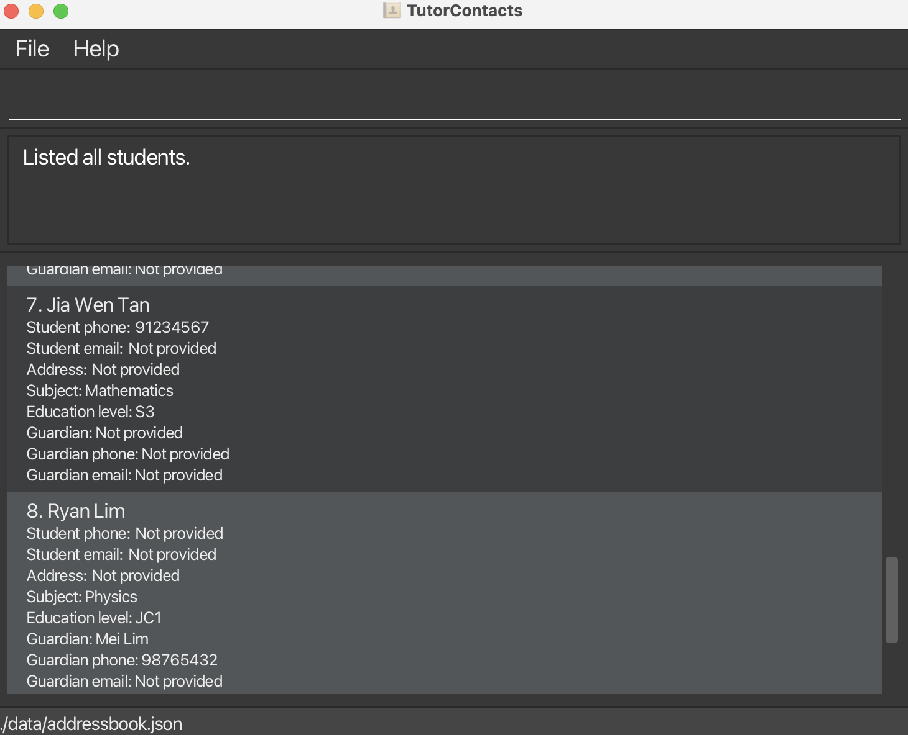
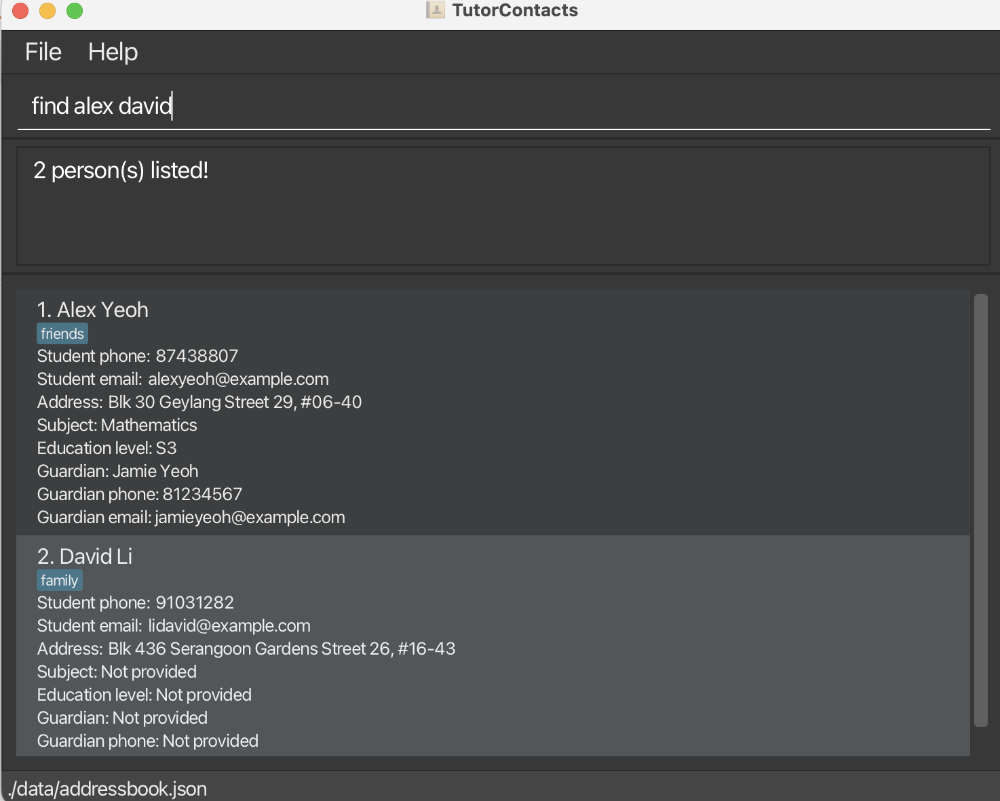

TutorContacts is an **offline desktop application for private tutors to manage student and guardian contact details, optimized for use through a Command Line Interface (CLI)** while retaining the benefits of a Graphical User Interface (GUI).

* Table of Contents
{:toc}

--------------------------------------------------------------------------------------------------------------------

## Quick start

1. Ensure that Java `25` or later is installed on your computer. 
   **Mac users:** Ensure you have the precise JDK version prescribed [here](https://se-education.org/guides/tutorials/javaInstallationMac.html).

1. Download the latest `.jar` file from [here](https://github.com/AY2627S1-CS2103T-W10-3/tp/releases).

1. Copy the file to the folder you want to use as the _home folder_ for TutorContacts.

1. Open a terminal, `cd` to the folder containing the JAR file, and run `java -jar addressbook.jar`. 
   A GUI similar to the one below should appear in a few seconds. Note how the app contains some sample data. 
   

1. Type a command in the command box and press Enter to execute it. For example, type **`help`** and press Enter to open the help window. 
   Some example commands you can try:

   * `list` : Lists all students.

   * `add n/John Doe p/98765432 gn/Jane Doe gp/91234567` : Adds a student named `John Doe` with optional student and guardian contact details.

   * `delete 3` : Deletes the 3rd contact shown in the current list.

   * `clear` : Deletes all contacts.

   * `exit` : Exits the app.

1. Refer to the [Features](#features) section below for details of each command.

--------------------------------------------------------------------------------------------------------------------

## Features

**:information_source: Notes about the command format:** 

* Words in `UPPER_CASE` are the parameters to be supplied by the user. 
  For example, in `add n/NAME`, replace `NAME` with a value such as `John Doe`.

* Items in square brackets are optional. 
  For example, `n/NAME [t/TAG]` can be used as `n/John Doe t/friend` or as `n/John Doe`.

* The prefixes in `add` can be in any order, with whitespace between fields. 
  For example, `add p/81234567 n/Alex Tan` is accepted. Each `add` prefix can appear only once.

* Extraneous parameters for commands that take no parameters, such as `help`, `list`, `exit`, and `clear`, are ignored. 
  For example, `help 123` is interpreted as `help`.

* If you are using a PDF version of this document, be careful when copying and pasting commands that span multiple lines as space characters surrounding line-breaks may be omitted when copied over to the application.

### Viewing help: `help`

Shows the command formats and important rules in the result panel and a help window. The help text is bundled with
TutorContacts, so `help` remains available without internet access and when the data file cannot be loaded. It does not
write to the data file. The help window also has a button to copy the online User Guide link.

Format: `help`

### Adding a student: `add`

Adds a student to TutorContacts. Only the student name is required; the remaining fields are optional.

Format: `add n/NAME [p/PHONE] [e/EMAIL] [a/ADDRESS] [s/SUBJECT] [l/EDUCATION_LEVEL] [gn/GUARDIAN_NAME] [gp/GUARDIAN_PHONE] [ge/GUARDIAN_EMAIL] [t/TAG]`

:bulb: **Tip:**
Only `n/` is required. Every other prefix is optional; each supported prefix can be supplied once, in any order.

| Prefix | Meaning and validation |
|--------|------------------------|
| `n/` | Student name. Required; letters, digits, and spaces; cannot be blank. |
| `p/` | Student phone. Optional; digits only, at least 3 digits. |
| `e/` | Student email. Optional; a valid email address. |
| `a/` | Address. Optional; nonblank text. |
| `s/` | Tutoring subject. Optional; nonblank text of at most 100 characters, without control characters. |
| `l/` | Education level. Optional; `P1`–`P6`, `S1`–`S5`, or `JC1`–`JC2`, regardless of input case. Displayed in uppercase. |
| `gn/` | Guardian name. Optional; uses the student-name rules. |
| `gp/` | Guardian phone. Optional; uses the student-phone rules and requires `gn/`. |
| `ge/` | Guardian email. Optional; uses the student-email rules and requires `gn/`. |
| `t/` | One optional tag; letters and digits only. |

Leading and trailing whitespace around field values is ignored. Repeated whitespace inside names, guardian names,
subjects, and addresses is stored as one space. Whitespace within phone numbers, email addresses, education levels, and
tags is not accepted. Text before the first prefix and unknown prefix-like tokens such as `x/value` are rejected.
When an input breaks several rules, TutorContacts reports one error predictably: unexpected preamble, unsupported
prefix, missing `n/`, repeated prefix, missing guardian name, then invalid field value. Repeated prefixes are listed in
alphabetical order in the error.

Student names are unique regardless of letter case and repeated spaces. For example, after adding `Alex Tan`,
`add n/ alex   tan` is rejected as a duplicate. Different students may share phone, email, and guardian details.
A guardian name may be supplied without guardian contact information.

Examples:
* Name only: `add n/Alex Tan`
* All tutoring and guardian details, in a different prefix order: `add l/jc1 gn/Mary Tan s/H2 Mathematics p/98765432 ge/mary@example.com gp/81234567 e/alex@example.com n/Alex Tan`
* Two students may share contacts: `add n/Ben Tan p/81234567 gn/Mary Tan gp/91234567` followed by `add n/Chloe Tan p/81234567 gn/Mary Tan gp/91234567`
* Invalid, because `gn/` is missing: `add n/Sam Lee gp/81234567`
* Invalid, because a prefix repeats: `add n/Sam Lee p/81234567 p/92345678`
* Invalid, because the education level is unsupported: `add n/Sam Lee l/University`
* Invalid, because of unexpected text: `add surprise n/Sam Lee` or `add n/Sam Lee x/value`

Rejected `add` commands leave the displayed records and saved data unchanged.

### Listing all students: `list`

Shows all student records in their saved order. If there are no records, TutorContacts shows guidance for adding one.
Student cards show the student's recorded contact, tutoring, and guardian details. Omitted details are shown as
`Not provided`.

After a command is submitted, the command box retains keyboard focus so you can type the next command immediately.
Use the mouse or Tab to focus the list when you want to scroll it or use its normal list navigation keys.

Format: `list`

Example: `list`

### Editing a person: `edit`

Edits an existing person in the address book.

Format: `edit INDEX [n/NAME] [p/PHONE] [e/EMAIL] [a/ADDRESS] [t/TAG]…​`

* Edits the person at the specified `INDEX`. The index refers to the index number shown in the displayed person list. The index **must be a positive integer** 1, 2, 3, …​
* At least one of the optional fields must be provided.
* Existing values will be updated to the input values.
* When editing tags, all of the person's existing tags are removed; adding tags is not cumulative.
* To remove all of a person's tags, enter `t/` without a tag after it.

Examples:
*  `edit 1 p/91234567 e/johndoe@example.com` Edits the phone number and email address of the 1st person to be `91234567` and `johndoe@example.com` respectively.
*  `edit 2 n/Betsy Crower t/` Edits the name of the 2nd person to be `Betsy Crower` and clears all existing tags.

### Locating persons by name: `find`

Finds persons whose names contain any of the given keywords.

Format: `find KEYWORD [MORE_KEYWORDS]`

* The search is case-insensitive; for example, `hans` matches `Hans`.
* Keyword order does not matter; for example, `Hans Bo` matches `Bo Hans`.
* The search considers only names.
* Only full words match; for example, `Han` does not match `Hans`.
* Persons matching at least one keyword are returned (an `OR` search); for example, `Hans Bo` returns `Hans Gruber` and `Bo Yang`.

Examples:
* `find John` returns `john` and `John Doe`
* `find alex david` returns `Alex Yeoh`, `David Li` 
  

### Deleting a person: `delete`

Deletes the specified student from TutorContacts. The result panel confirms the deleted student's details.

Format: `delete INDEX`

* Deletes the student at the specified `INDEX`.
* The index refers to the index number shown in the displayed student list.
* The index **must be a positive integer** 1, 2, 3, …​
* Missing, malformed, zero, negative, extra, or out-of-range indices are rejected.

Examples:
* `list` followed by `delete 2` deletes the 2nd student in TutorContacts.
* `find Betsy` followed by `delete 1` deletes the 1st student in the results of the `find` command.
* `delete 0` and `delete 1 2` are rejected.

### Clearing all entries: `clear`

Clears all entries from the address book.

Format: `clear`

### Exiting the program: `exit`

Exits the program.

Format: `exit`

Example: `exit`

### Saving the data

TutorContacts automatically saves data changes. You do not need to save manually. The `help` command can be used even
when the data file cannot be read or written, and does not change that file.

### Editing the data file

TutorContacts data is saved automatically as a JSON file `[JAR file location]/data/addressbook.json`. Advanced users are welcome to update data directly by editing that data file.

:exclamation: **Caution:**
If your changes make the data file invalid, TutorContacts starts with an empty address book at the next run. The invalid file remains on disk when you use `help`; a data-changing command can replace it. We recommend backing up the file before editing it. 
Furthermore, certain edits can cause the AddressBook to behave in unexpected ways (e.g., if a value entered is outside of the acceptable range). Therefore, edit the data file only if you are confident that you can update it correctly.

### Archiving data files `[coming in v2.0]`

_Details coming soon ..._

--------------------------------------------------------------------------------------------------------------------

## FAQ

**Q**: How do I transfer my data to another computer? 
**A**: Install the app on the other computer and overwrite the data file it creates with the data file from your previous AddressBook home folder.

--------------------------------------------------------------------------------------------------------------------

## Known issues

1. **When using multiple screens**, if you move the application to a secondary screen, and later switch to using only the primary screen, the GUI will open off-screen. The remedy is to delete the `preferences.json` file created by the application before running the application again.
2. **If you minimize the Help Window** and then run the `help` command (or use the `Help` menu, or the keyboard shortcut `F1`) again, the original Help Window will remain minimized, and no new Help Window will appear. The remedy is to manually restore the minimized Help Window.

--------------------------------------------------------------------------------------------------------------------

## Command summary

Action | Format, Examples
--------|------------------
**Add** | `add n/NAME [p/PHONE] [e/EMAIL] [a/ADDRESS] [s/SUBJECT] [l/EDUCATION_LEVEL] [gn/GUARDIAN_NAME] [gp/GUARDIAN_PHONE] [ge/GUARDIAN_EMAIL] [t/TAG]`   e.g., `add n/James Ho p/22224444 s/Mathematics l/S3 gn/Mary Ho gp/81234567`
**Clear** | `clear`
**Delete** | `delete INDEX`  e.g., `delete 3`
**Edit** | `edit INDEX [n/NAME] [p/PHONE_NUMBER] [e/EMAIL] [a/ADDRESS] [t/TAG]…​`  e.g., `edit 2 n/James Lee e/jameslee@example.com`
**Find** | `find KEYWORD [MORE_KEYWORDS]`  e.g., `find James Jake`
**List** | `list`
**Help** | `help`
**Exit** | `exit`
