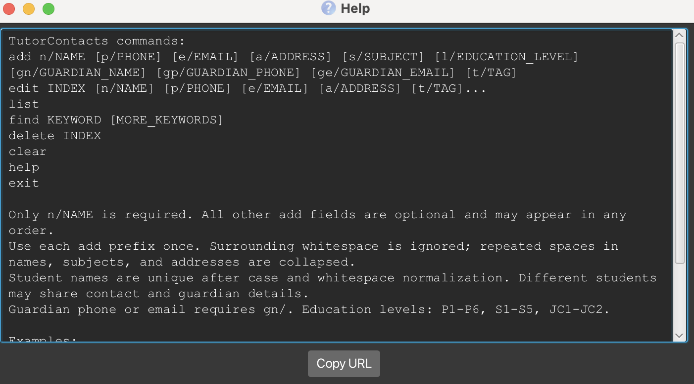

TutorContacts is an **offline desktop application for private tutors to manage student and guardian contact details, optimized for use through a Command Line Interface (CLI)** while retaining the benefits of a Graphical User Interface (GUI).

* Table of Contents
{:toc}

--------------------------------------------------------------------------------------------------------------------

## Quick start

1. Ensure that Java `25` or later is installed on your computer. 
   **Mac users:** Ensure you have the precise JDK version prescribed [here](https://se-education.org/guides/tutorials/javaInstallationMac.html).

1. Download the latest `.jar` file from [here](https://github.com/AY2627S1-CS2103T-W10-3/tp/releases).

1. Copy the file to the folder you want to use as the _home folder_ for TutorContacts.

1. Open a terminal, `cd` to the folder containing the JAR file, and run `java -jar addressbook.jar`. 
   A GUI similar to the one below should appear in a few seconds. Note how the app contains some sample data. 
   

1. Type a command in the command box and press Enter to execute it. For example, type **`help`** and press Enter to open the help window. 
   Some example commands you can try:

   * `list` : Lists all students.

   * `add n/John Doe p/98765432 gn/Jane Doe gp/91234567` : Adds a student named `John Doe` with optional student and guardian contact details.

   * `delete 3` : Deletes the 3rd contact shown in the current list.

   * `clear` : Deletes all contacts.

   * `exit` : Exits the app.

1. Refer to the [Features](#features) section below for details of each command.

--------------------------------------------------------------------------------------------------------------------

## Features

**:information_source: Notes about the command format:** 

* Words in `UPPER_CASE` are the parameters to be supplied by the user. 
  For example, in `add n/NAME`, replace `NAME` with a value such as `John Doe`.

* Items in square brackets are optional. 
  For example, `n/NAME [t/TAG]` can be used as `n/John Doe t/friend` or as `n/John Doe`.

* Items followed by `…`​ can appear zero or more times. 
  For example, `[t/TAG]…​` may be omitted, or written as `t/friend` or `t/friend t/family`.

* Parameters can be in any order. 
  For example, if the command specifies `n/NAME p/PHONE_NUMBER`, `p/PHONE_NUMBER n/NAME` is also acceptable.

* Extraneous parameters for commands that take no parameters, such as `help`, `list`, `exit`, and `clear`, are ignored. 
  For example, `help 123` is interpreted as `help`.

* If you are using a PDF version of this document, be careful when copying and pasting commands that span multiple lines as space characters surrounding line-breaks may be omitted when copied over to the application.

### Viewing help: `help`

Shows a message explaining how to access the help page.

Format: `help`

### Adding a student: `add`

Adds a student to TutorContacts. Only the student name is required; the remaining fields are optional.

Format: `add n/NAME [p/PHONE_NUMBER] [e/EMAIL] [a/ADDRESS] [s/SUBJECT] [l/EDUCATION_LEVEL] [gn/GUARDIAN_NAME] [gp/GUARDIAN_PHONE] [ge/GUARDIAN_EMAIL] [t/TAG]…​`

:bulb: **Tip:**
A student can have any number of tags, including zero. All supported prefixes can be supplied in any order.

Guardian details are optional. If `gp/` or `ge/` is supplied, `gn/` must also be supplied. A guardian name may be recorded without a guardian phone number or email address. Different students may share the same guardian contact details.

Subject and education level are optional and may be supplied independently. Education levels are case-insensitive when entered and are displayed in uppercase. For example, `l/jc1` is displayed as `JC1`. If either field is omitted, the student card displays `Not provided` for that field.

Validation rules:
* `s/` must not be blank, exceed 100 characters, or contain control characters.
* `l/` must be one of `P1`–`P6`, `S1`–`S5`, or `JC1`–`JC2`, ignoring letter case.
* `gn/` uses the same name rules as the student name.
* `gp/` uses the same phone-number rules as the student phone number.
* `ge/` uses the same email-address rules as the student email address.
* Repeating any single-valued prefix, including a guardian prefix, is rejected.

Examples:
* Subject and education level: `add n/Alex Tan s/H2 Mathematics l/JC1`
* Subject without education level: `add n/Ben Tan s/English Language`
* Lowercase education level, displayed as `S3`: `add n/Chloe Tan l/s3`
* Invalid because the education level is unsupported: `add n/Dan Lee s/Mathematics l/University`
* Invalid because the subject is empty: `add n/Eva Lim s/ l/P6`
* Complete guardian details: `add n/John Doe p/98765432 e/johnd@example.com gn/Jane Doe gp/91234567 ge/jane@example.com`
* Guardian name only: `add n/Alex Tan gn/Mary Tan`
* Two siblings may share guardian contacts: `add n/Ben Tan gn/Mary Tan gp/81234567` followed by `add n/Chloe Tan gn/Mary Tan gp/81234567`
* Invalid because the guardian name is missing: `add n/Sam Lee gp/81234567`
* Invalid guardian email: `add n/Sam Lee gn/Pat Lee ge/pat.example.com`

### Listing all persons: `list`

Shows the current list of students. Student cards show the student's name and recorded phone, email, and address. Omitted contact details are shown as `Not provided`.

After a command is submitted, the command box retains keyboard focus so you can type the next command immediately. Use the mouse or Tab to focus the list when you want to scroll it or use its normal list navigation keys.

Format: `list`

### Editing a person: `edit`

Edits an existing person in the address book.

Format: `edit INDEX [n/NAME] [p/PHONE] [e/EMAIL] [a/ADDRESS] [t/TAG]…​`

* Edits the person at the specified `INDEX`. The index refers to the index number shown in the displayed person list. The index **must be a positive integer** 1, 2, 3, …​
* At least one of the optional fields must be provided.
* Existing values will be updated to the input values.
* When editing tags, all of the person's existing tags are removed; adding tags is not cumulative.
* To remove all of a person's tags, enter `t/` without a tag after it.

Examples:
*  `edit 1 p/91234567 e/johndoe@example.com` Edits the phone number and email address of the 1st person to be `91234567` and `johndoe@example.com` respectively.
*  `edit 2 n/Betsy Crower t/` Edits the name of the 2nd person to be `Betsy Crower` and clears all existing tags.

### Locating persons by name: `find`

Finds persons whose names contain any of the given keywords.

Format: `find KEYWORD [MORE_KEYWORDS]`

* The search is case-insensitive; for example, `hans` matches `Hans`.
* Keyword order does not matter; for example, `Hans Bo` matches `Bo Hans`.
* The search considers only names.
* Only full words match; for example, `Han` does not match `Hans`.
* Persons matching at least one keyword are returned (an `OR` search); for example, `Hans Bo` returns `Hans Gruber` and `Bo Yang`.

Examples:
* `find John` returns `john` and `John Doe`
* `find alex david` returns `Alex Yeoh`, `David Li` 
  

### Deleting a person: `delete`

Deletes the specified student from TutorContacts. The result panel confirms the deleted student's details.

Format: `delete INDEX`

* Deletes the student at the specified `INDEX`.
* The index refers to the index number shown in the displayed student list.
* The index **must be a positive integer** 1, 2, 3, …​

Examples:
* `list` followed by `delete 2` deletes the 2nd person in the address book.
* `find Betsy` followed by `delete 1` deletes the 1st person in the results of the `find` command.

### Clearing all entries: `clear`

Clears all entries from the address book.

Format: `clear`

### Exiting the program: `exit`

Exits the program.

Format: `exit`

### Saving the data

TutorContacts automatically saves data after every command. You do not need to save manually.

### Editing the data file

TutorContacts data is saved automatically as a JSON file `[JAR file location]/data/addressbook.json`. Advanced users are welcome to update data directly by editing that data file.

:exclamation: **Caution:**
If your changes make the data file invalid, AddressBook starts with an empty address book at the next run. The invalid file remains on disk until you run a command (AddressBook saves after every command). Still, we recommend backing up the file before editing it. 
Furthermore, certain edits can cause the AddressBook to behave in unexpected ways (e.g., if a value entered is outside of the acceptable range). Therefore, edit the data file only if you are confident that you can update it correctly.

### Archiving data files `[coming in v2.0]`

_Details coming soon ..._

--------------------------------------------------------------------------------------------------------------------

## FAQ

**Q**: How do I transfer my data to another computer? 
**A**: Install the app on the other computer and overwrite the data file it creates with the data file from your previous AddressBook home folder.

--------------------------------------------------------------------------------------------------------------------

## Known issues

1. **When using multiple screens**, if you move the application to a secondary screen, and later switch to using only the primary screen, the GUI will open off-screen. The remedy is to delete the `preferences.json` file created by the application before running the application again.
2. **If you minimize the Help Window** and then run the `help` command (or use the `Help` menu, or the keyboard shortcut `F1`) again, the original Help Window will remain minimized, and no new Help Window will appear. The remedy is to manually restore the minimized Help Window.

--------------------------------------------------------------------------------------------------------------------

## Command summary

Action | Format, Examples
--------|------------------
**Add** | `add n/NAME [p/PHONE_NUMBER] [e/EMAIL] [a/ADDRESS] [s/SUBJECT] [l/EDUCATION_LEVEL] [gn/GUARDIAN_NAME] [gp/GUARDIAN_PHONE] [ge/GUARDIAN_EMAIL] [t/TAG]…​`   e.g., `add n/James Ho s/H2 Mathematics l/JC1 gn/Mary Ho gp/81234567`
**Clear** | `clear`
**Delete** | `delete INDEX`  e.g., `delete 3`
**Edit** | `edit INDEX [n/NAME] [p/PHONE_NUMBER] [e/EMAIL] [a/ADDRESS] [t/TAG]…​`  e.g., `edit 2 n/James Lee e/jameslee@example.com`
**Find** | `find KEYWORD [MORE_KEYWORDS]`  e.g., `find James Jake`
**List** | `list`
**Help** | `help`
